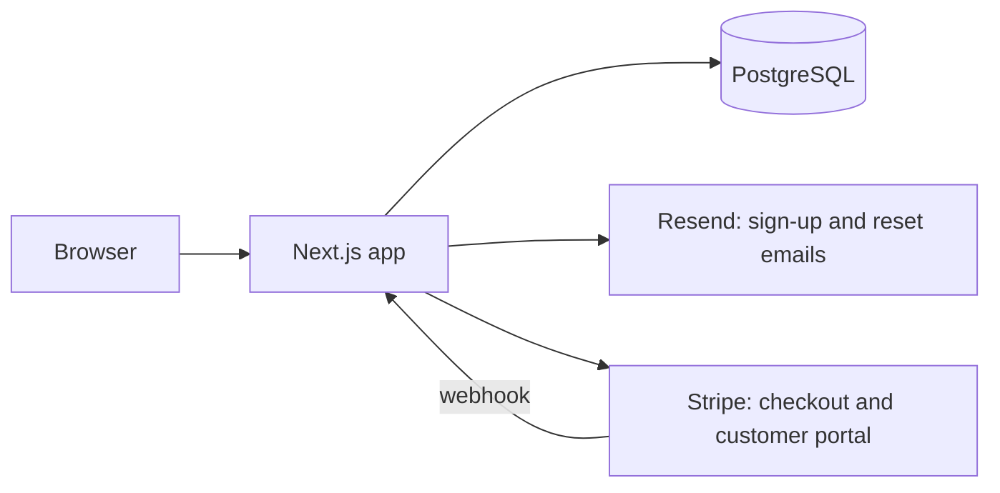

# Start a SaaS on Light Cloud

The app for the **Start a SaaS on Light Cloud** tutorial series. It's a complete SaaS on Next.js 16 and PostgreSQL. By the end of the series it runs on its own domain, sends real emails, takes payments with Stripe, has a password-protected staging site and gets a preview for every pull request.

The code is the [Next.js SaaS Starter Kit](https://github.com/light-cloud-dev/nextjs-saas-starter) (MIT), with this README and two links pointing at the series. It uses Next.js 16, React 19, TypeScript, Better Auth, Drizzle ORM, Tailwind CSS and shadcn/ui.



## What's in it

- **Accounts**: email and password sign-up, sign-in and password reset, plus email verification once Resend is set up.
- **Teams**: workspaces with owner, admin and member roles, and invitations by email or link.
- **Onboarding**: a short stepper after the first sign-up.
- **Billing**: Stripe Checkout, the Stripe customer portal and a webhook that keeps each workspace's plan in sync. Plans and limits live in `src/lib/plans.ts`.
- **Admin panel** at `/admin`. The first account to sign up is the admin.
- **REST API** with per-workspace API keys, at `/api/v1/projects`.
- **Operations**: database migrations run on every start, and `GET /api/health` reports the app and the database.

## Run it on your laptop

You need Node.js 22.12 or newer and Docker for a local PostgreSQL.

```bash
git clone https://github.com/light-cloud-com/tutorial-saas-starter.git
cd tutorial-saas-starter
docker run -d --name saas-db -p 5432:5432 -e POSTGRES_PASSWORD=postgres postgres:17
cp .env.example .env.local
npm install
npm run dev
```

Before `npm run dev`, set `AUTH_SECRET` in `.env.local` to a long random string. `openssl rand -hex 32` prints one.

Open <http://localhost:3000> and sign up. Until you set `RESEND_API_KEY`, emails are printed in the terminal instead of being sent.

## Environment variables

| Name | Needed from | What it does |
| --- | --- | --- |
| `DATABASE_URL` | Part 1 | PostgreSQL connection URL |
| `AUTH_SECRET` | Part 1 | Signs sessions and email tokens. Any long random string |
| `APP_NAME` | Part 1 | Product name in the header, page titles and emails |
| `RESEND_API_KEY`, `EMAIL_FROM` | Part 2 | Send emails through Resend and turn on email verification |
| `STRIPE_SECRET_KEY`, `STRIPE_WEBHOOK_SECRET`, `STRIPE_PRICE_PRO`, `STRIPE_PRICE_BUSINESS` | Part 3 | Turn on billing. All four are needed |
| `APP_URL` | Part 4 | The public URL, once the app has its own domain |
| `ADMIN_EMAILS` | Optional | More admin accounts, comma-separated |
| `GITHUB_CLIENT_ID`, `GITHUB_CLIENT_SECRET`, `GOOGLE_CLIENT_ID`, `GOOGLE_CLIENT_SECRET` | Optional | GitHub and Google sign-in |

None of these reach the browser.

## Tutorials

1. [Deploy your app and database](https://blog.light-cloud.com/tutorials/start-a-saas-part-1-deploy)
2. [Send sign-up emails with Resend](https://blog.light-cloud.com/tutorials/start-a-saas-part-2-email)
3. [Take payments with Stripe, in test mode](https://blog.light-cloud.com/tutorials/start-a-saas-part-3-stripe)
4. [Add your own domain](https://blog.light-cloud.com/tutorials/start-a-saas-part-4-custom-domain)
5. [Add a password-protected staging site](https://blog.light-cloud.com/tutorials/start-a-saas-part-5-staging)
6. [Preview every pull request](https://blog.light-cloud.com/tutorials/start-a-saas-part-6-previews)
7. [Go live with real payments](https://blog.light-cloud.com/tutorials/start-a-saas-part-7-go-live)

## Licence

MIT, see [LICENSE](LICENSE).
